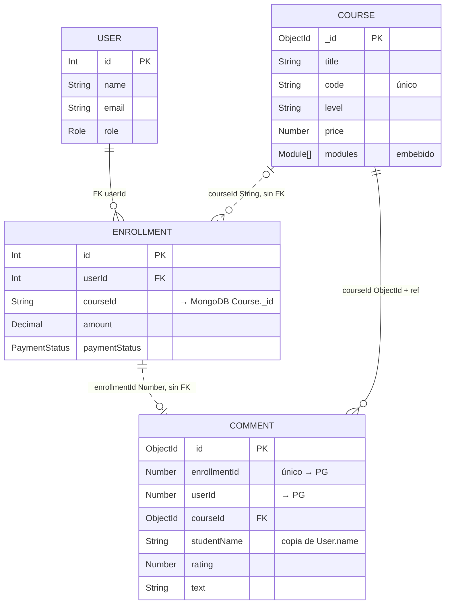

# Tarea individual U2 · Modelo híbrido PostgreSQL + MongoDB

**Estudiante:** Nicolás Zurita  **N.º de lista:** 20  **Caso:** 8 · Cursos en línea

## 1. Workload

### 1.1 Casos de uso
- Un estudiante se registra, inicia sesión y consulta el catálogo de cursos (por nombre, código o nivel).
- El estudiante se **matricula** en un curso; la matrícula registra el monto y el estado de pago.
- Después de pagar, el estudiante deja un **comentario** con calificación sobre el curso.
- Cualquier visitante lee los comentarios de un curso con su promedio.
- El estudiante ve sus matrículas junto con los datos del curso.
- Un administrador/instructor mantiene el catálogo (crea, edita y borra cursos).

### 1.2 Datos principales
- Estudiantes: ~5 000 (crecen ~200 por mes).
- Cursos: ~80 en el catálogo, cada uno con 5 a 20 módulos.
- Matrículas: ~150 por día; se guardan de forma indefinida (historial de pagos).
- Comentarios: ~60 por día (una parte de las matrículas); **crecen sin límite** (~100 000 en 5 años).
- Lecturas del catálogo: ~8 000 por día.

### 1.3 Suposiciones
- Un estudiante **no puede matricularse dos veces** en el mismo curso (integridad fuerte).
- Una matrícula tiene como máximo **un** comentario, y solo si está pagada.
- El monto de la matrícula lo define el catálogo, no el cliente.
- Los módulos de un curso **se leen siempre junto con el curso** y no existen fuera de él.
- El nombre del estudiante casi nunca cambia, por eso se copia en el comentario.
- El catálogo cambia poco, pero cada curso puede tener módulos distintos (cantidad y contenido).

### 1.4 Operaciones

| Actor: | Estudiante |
|---|---|
| Descripción: | Consulta el catálogo de cursos con búsqueda por texto, filtro por nivel y orden |
| Tipo de operación: | Lectura |
| Datos en la operación: | title, code, level, price, modules[] |
| Frecuencia: | En cada visita a la página de cursos |
| Tasa: | ~8 000 / día |
| Base: | **MongoDB** (documento listo para mostrar, con los módulos embebidos) |

| Actor: | Estudiante |
|---|---|
| Descripción: | Se matricula en un curso |
| Tipo de operación: | Escritura |
| Datos en la operación: | userId (del JWT), courseId, amount (tomado del catálogo), paymentStatus |
| Frecuencia: | Picos al inicio de cada ciclo |
| Tasa: | ~150 / día |
| Base: | **PostgreSQL** (unicidad userId+courseId y monto exacto); lee MongoDB para validar que el curso exista |

| Actor: | Estudiante |
|---|---|
| Descripción: | Ve sus matrículas con título, código y nivel del curso |
| Tipo de operación: | Lectura |
| Datos en la operación: | Enrollment (PostgreSQL) + title, code, level, duración (MongoDB) |
| Frecuencia: | ~1 vez al día por estudiante activo |
| Tasa: | ~1 500 / día |
| Base: | **Las dos**: se une en el servicio con `$in` + `Map` (2 consultas, sin N+1) |

| Actor: | Estudiante |
|---|---|
| Descripción: | Paga una matrícula |
| Tipo de operación: | Escritura |
| Datos en la operación: | enrollmentId, paymentStatus = PAID |
| Frecuencia: | Una por matrícula |
| Tasa: | ~150 / día |
| Base: | **PostgreSQL** (estado de pago transaccional) |

| Actor: | Estudiante |
|---|---|
| Descripción: | Comenta y califica un curso al que está matriculado y pagó |
| Tipo de operación: | Escritura |
| Datos en la operación: | enrollmentId, rating, text; userId del JWT; studentName copiado de PostgreSQL |
| Frecuencia: | Una parte de las matrículas pagadas |
| Tasa: | ~60 / día (sin límite en el tiempo) |
| Base: | **MongoDB**, colección aparte; lee PostgreSQL para validar la matrícula (404), su dueño (403) y el pago |

| Actor: | Visitante / estudiante |
|---|---|
| Descripción: | Lee los comentarios de un curso y su promedio |
| Tipo de operación: | Lectura |
| Datos en la operación: | studentName, rating, text, createdAt; promedio y total |
| Frecuencia: | Al abrir el detalle de un curso |
| Tasa: | ~5 000 / día |
| Base: | **MongoDB** solamente (por eso se copia `studentName`); `populate` + `aggregate` |

| Actor: | Administrador |
|---|---|
| Descripción: | Crea, edita o borra un curso del catálogo |
| Tipo de operación: | Escritura |
| Datos en la operación: | title, code, description, level, price, modules[] |
| Frecuencia: | Pocas veces al mes |
| Tasa: | ~10 / mes |
| Base: | **MongoDB**; al borrar consulta PostgreSQL (409 si hay matrículas) y borra en cascada los comentarios |

### 1.5 Entidades

- **PostgreSQL**
  - `User` (id, name, email, password, role)
  - `Enrollment` (id, userId → User, courseId String?, amount, paymentStatus, createdAt)
- **MongoDB**
  - `Course` (title, code, description, level, price, modules[] embebidos, slug, createdAt)
  - `Comment` (enrollmentId, userId, courseId → Course, studentName, rating, text, createdAt)
- **Entre bases (sin FK)**
  - `Enrollment.courseId` (String) → `Course._id`
  - `Comment.enrollmentId` (Number) → `Enrollment.id`
  - `Comment.userId` (Number) → `User.id`

### 1.6 Observaciones
- El catálogo domina en **lectura** (8 000/día) y casi no se escribe. Sus módulos varían de curso a curso.
- Los comentarios **crecen sin límite**; por eso no se embeben en el curso (superarían el límite de 16 MB de un documento).
- Lo que necesita **integridad** es la matrícula: no duplicarla y guardar el monto exacto.

## 2. ¿PostgreSQL o MongoDB?

| Entidad | ¿Transacciones o choques? | ¿Otras dependen por FK? | ¿Forma variable? | ¿Crece sin límite? | ¿Se lee mucho más? | Base |
|---|---|---|---|---|---|---|
| User | Sí (email único) | Sí (Enrollment) | No | No | No | PostgreSQL |
| Enrollment | **Sí**: no duplicar y monto exacto | Referenciada por Comment (lógica) | No | Lento | No | **PostgreSQL** |
| Course | No | No (solo referencias lógicas) | **Sí**: módulos[] variables | No (~80) | **Sí** (8 000/día) | **MongoDB** |
| Comment | No | No | Algo (texto libre) | **Sí** | Se lee por curso | **MongoDB** |

## 3. Relaciones dentro de MongoDB: embeber o referenciar

| Relación | Cardinalidad | ¿Se lee junto? | ¿Cambia seguido? | ¿Crece sin límite? | Decisión |
|---|---|---|---|---|---|
| Course → módulos | 1:N (5 a 20) | **Sí**, siempre con el curso | No | No | **Embeber** (`modules: [moduleSchema]`) |
| Course → comentarios | 1:N | No, se leen por separado | Sí (se agregan) | **Sí** | **Referenciar** (`Comment.courseId` con `ref`) |

## 4. ERD híbrido

Zona **PostgreSQL**: `USER`, `ENROLLMENT`. Zona **MongoDB**: `COURSE` (con `modules[]` embebido) y `COMMENT`. Las líneas punteadas (`..`) son referencias entre bases, sin FK.

## 5. Referencias

| Referencia | Se guarda como | La garantiza | Se une con |
|---|---|---|---|
| Enrollment → User | `userId Int` (FK) | PostgreSQL (clave foránea) | `include` de Prisma |
| Enrollment → Course | `courseId String?` (el `_id` como texto) | **El servicio**: `isValidObjectId` + `Course.exists` antes de crear | `Course.find({ _id: { $in } })` + `Map` |
| Comment → Enrollment | `enrollmentId Number` | **El servicio**: `prisma.enrollment.findUnique` (404/403) y índice único (409) | Consulta por id con Prisma |
| Comment → User | `userId Number` | El servicio (sale del JWT) | No se une; se copia `studentName` |
| Comment → Course | `courseId ObjectId` con `ref` | Mongoose | `populate("courseId")` |

## 6. Dato copiado entre bases (desnormalización)

- **Dato:** `studentName` (de `User.name` en PostgreSQL) dentro de `Comment`.
- **Por qué (operación del workload):** "Lee los comentarios de un curso" (~5 000/día) debe resolverse solo con MongoDB, sin consultar PostgreSQL por cada comentario.
- **Costo:** si el estudiante cambia su nombre, los comentarios antiguos conservan el nombre viejo (se acepta porque casi nunca cambia). Cada comentario nuevo necesita una lectura extra a PostgreSQL al crearse.

## 7. Endpoints

| Método y ruta | Base(s) | Respuestas posibles |
|---|---|---|
| `POST /api/auth/register`, `POST /api/auth/login` | PostgreSQL | 201, 200, 400 |
| `POST /api/courses` (JWT) | MongoDB | 201, 400, 401, 409 (código repetido) |
| `GET /api/courses?q=&fields=&sort=&level=` | MongoDB | 200 |
| `GET /api/courses/:id` | MongoDB | 200, 400, 404 |
| `PUT /api/courses/:id` (JWT) | MongoDB | 200, 400, 401, 404 |
| `DELETE /api/courses/:id` (JWT) | Las dos | 200 (cascada de comentarios), 400, 404, **409** si hay matrículas |
| `POST /api/enrollments` (JWT) | PostgreSQL + valida MongoDB | 201, 400, 404 (curso), 409 (duplicada) |
| `GET /api/enrollments/me` (JWT) | Las dos (`$in` + `Map`) | 200 |
| `PATCH /api/enrollments/:id/pay` (JWT) | PostgreSQL | 200, 403, 404 |
| `DELETE /api/enrollments/:id` (JWT) | Las dos (borra su comentario) | 200, 403, 404 |
| `POST /api/comments` (JWT) | MongoDB + valida PostgreSQL | 201, 400, 403, 404, 409 |
| `GET /api/courses/:id/comments` | MongoDB (`populate` + `aggregate`) | 200, 400, 404 |
